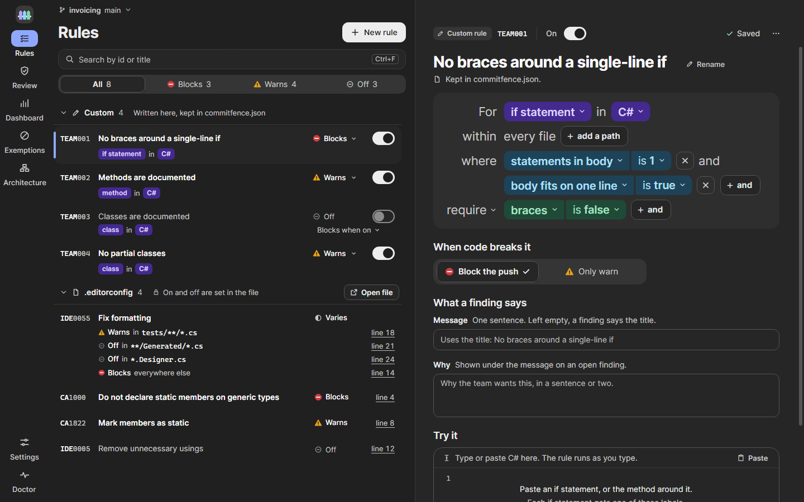
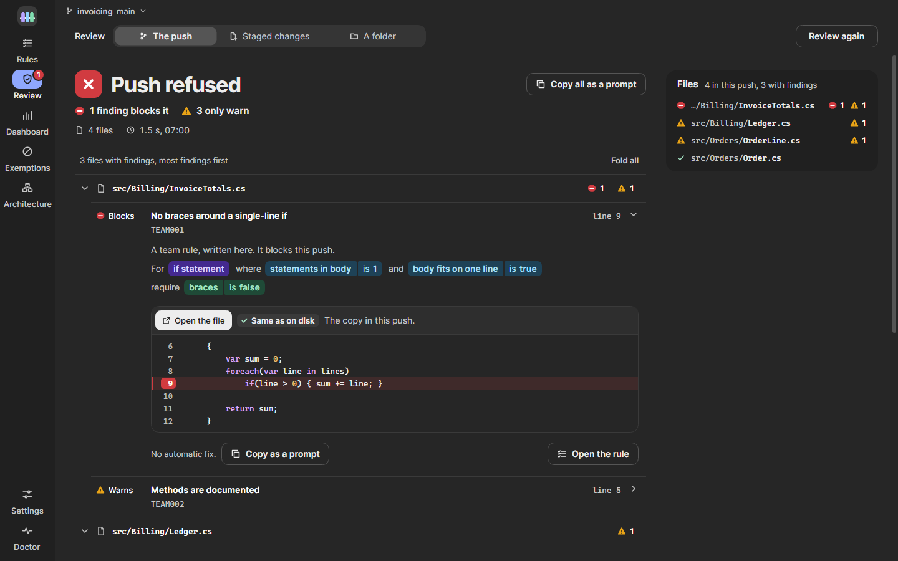
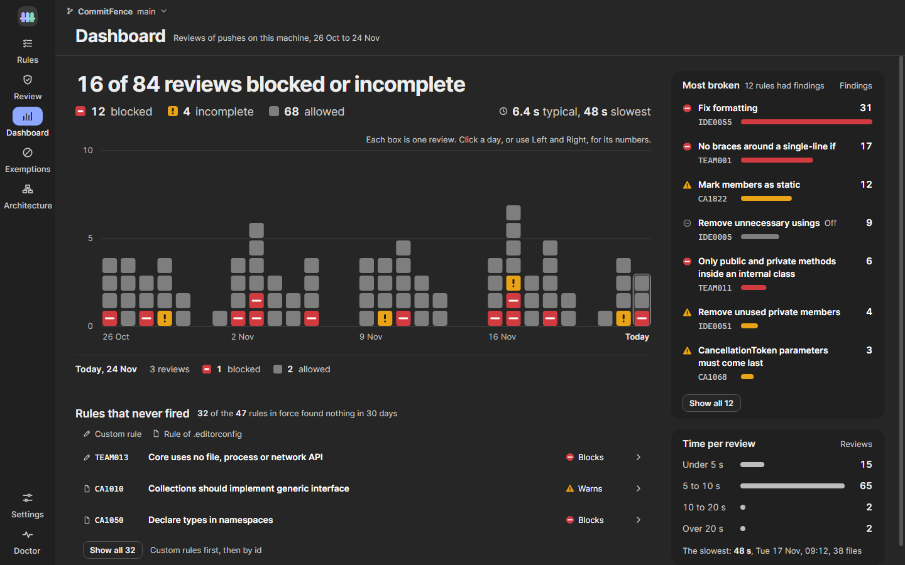
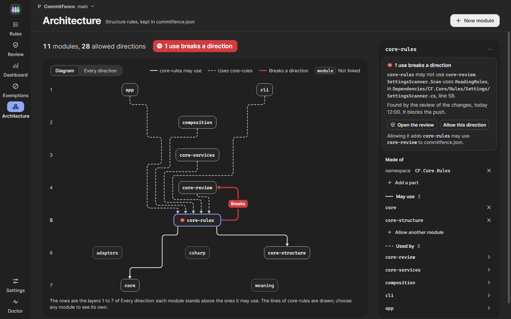

<p align="center">
  
</p>

<h1 align="center">CommitFence</h1>

<p align="center">
  <a href="https://github.com/TheSharpFactory/CommitFence/actions/workflows/ci.yml"></a>
  <a href="https://github.com/TheSharpFactory/CommitFence/actions/workflows/ci-macos.yml"></a>
  <a href="https://github.com/TheSharpFactory/CommitFence/releases/latest"></a>
  <a href="LICENSE"></a>
</p>

<p align="center">
  A code reviewer for C# that runs before a push and refuses it when the code breaks a rule your team wrote.<br>
  Free and open source. For Windows, macOS and Linux.<br>
  One of <a href="https://www.thesharpfactory.com">The Sharp Factory</a> products.
</p>

<p align="center">
  <a href="https://github.com/TheSharpFactory/CommitFence/releases/latest"><strong>Download</strong></a> ·
  <a href="https://github.com/TheSharpFactory/CommitFence/issues">Questions and bugs</a>
</p>

CommitFence reads what a push would send, builds the changed projects with your own compiler, and judges the code
against the rules in `commitfence.json` and the rules your `.editorconfig` already sets. A rule that blocks stops the
push, with the file, the line and the reason. Only what the push touches is judged, so an old breach in code you did
not change never stops you. It comes as a command line, for the `pre-push` hook, and an app, to write and try rules
and to read a review.

## Try it

1. **Download** the [latest release](https://github.com/TheSharpFactory/CommitFence/releases/latest) for your
   system: `CommitFence-win-x64.zip` (or `win-arm64`), `CommitFence-osx-arm64.zip` (or `osx-x64`) or
   `CommitFence-linux-x64.tar.gz` holds the app with the command line beside it; the `commitfence-cli-*` downloads hold
   the command line alone. Unzip it into a folder you can write to. It is self-contained, so you do not need .NET to
   run it.
2. **Install the command line** for your user: run `commitfence install`. It records where the program is and puts its
   folder on your `PATH`.
3. **Set a repository up:** in the repository, run `commitfence init`. It writes a `commitfence.json` with no rules and
   adds the review as the first command of a supported `pre-push` hook. For an unrecognised hook, it prints the path and
   the line to add. Use `--hook pre-commit` for a build-free review of the staged files, or `--print` to preview both writes.
   In the app, Rules can start the settings file and Doctor can preview and add the line to a supported existing hook.

   ```
   p="$(git config --get commitfence.path)"; [ -n "$p" ] && [ -f "$p" ] || { echo "CommitFence is not set up on this machine: run commitfence install from the folder you unpacked it to." >&2; exit 1; }; "$p" review --hook pre-push "$@" || exit $?
   ```
4. **Add a rule** (below), then push. A push that breaks a rule that blocks is refused and says why.
5. **The app:** start `commitfenceapp.exe` from a terminal in the repository's folder, or give it the folder as its
   argument. It opens on the Rules screen.

You can review without the hook: `commitfence review --push` says what the hook would say for the current branch.

## A quick look

**Rules.** The team's rules and the rules of `.editorconfig`, each as a sentence you can edit. Try it, under the rule,
runs the rule on the code you type or paste and marks each place that breaks it, follows it or is not covered.



**Review.** What the push would send: the verdict, every finding under its file with the code around it, and the files
of the push, or of the staged changes before a commit: every file the review covered, the ones without findings in a list
you can filter. "Open at line" opens a finding's file at its line, and says so
when the code on disk has moved. A finding of a rule of `.editorconfig` can be fixed there: the SDK's formatter
prepares the change, you see all of it, and "Apply fix" writes it.



**Dashboard.** The reviews of pushes on this machine in the last 30 days: how many were blocked or incomplete, which
rules found the most, which never fired, and how long a push waited.



**Architecture.** The modules of the repository in layers, each above the ones it may use, and the use that breaks a
direction in red. Every direction is also a list by layer, and each change is saved at once.



**Exemptions, Settings and Doctor.** Every line that sets a rule aside, with its reason; the strictness of the
repository, a preset or your own, the version and its updates; and seven checks of whether a push from this machine will
be reviewed, each with how to fix it.

## The command line

| Command | What it does |
|---|---|
| `commitfence install [--print] [--no-path]` | Sets the program up for your user |
| `commitfence init [--hook pre-push\|pre-commit] [--print]` | Starts `commitfence.json` and adds the line to a supported hook. `--print` previews the changes. |
| `commitfence doctor` | Checks whether pushes from this repository will be reviewed and explains how to fix failed checks |
| `commitfence settings show`, `set strictness <quiet\|standard\|strict>` | Shows or changes what the severity words in `.editorconfig` do to a push |
| `commitfence stats [--all]` | Shows the push reviews on this machine from the last 30 days, from the hook, the command line and the app's Review: the rules they found and how long they took. Use `--all` to list every rule that never fired |
| `commitfence structure show`, `structure set` | Shows modules, allowed directions and the last structure judgment, or edits a module, part or direction |
| `commitfence exemptions list [--rule <id>]` | Lists the lines of the last commit that set a rule aside, by file, with the reason each one gives |
| `commitfence catalog [<language> [<artifact type>]]` | Lists what a rule can be about and the properties it can look at |
| `commitfence rules list`, `show <id>` | Lists the rules, or shows one, including the rules `.editorconfig` sets |
| `commitfence rules add`, `set`, `copy`, `remove` | Writes, changes, copies and removes a team rule |
| `commitfence rules enable`, `disable`, `severity <id> block\|warn` | Switches a rule, or chooses whether it blocks or only warns |
| `commitfence rules try <id> [<file>]` | Runs a rule on a file, or on standard input if the rule does not read the file's name |
| `commitfence review --push` | Reviews what a push of the current branch would send |
| `commitfence review --staged [--quick]` | Reviews what is staged. `--quick` skips the build and rules that depend on it. |
| `commitfence fix <rule> <file> [--apply]` | Previews an .editorconfig fix for the whole file, or applies it if the file still matches the reviewed version. Uses the pushed changes by default. Select a local branch with `--head`, or use `--staged`, `--base` / `--head`, or `--all`. |
| `commitfence review --base <revision> [--head <revision>]` | Reviews a range of commits |
| `commitfence review --files <path>... [--quick]` | Reviews the named files. `--quick` treats the rules requiring a build as intentionally omitted. |
| `commitfence review --all [<folder or project file>]` | Reviews the whole of a folder, as of the last commit |
| `commitfence review ... --format prompt` | Prints what was found as a prompt to hand to an AI coding agent, in place of the usual report |
| `commitfence review ... --format sarif` | Prints what was found as a SARIF 2.1.0 log, in place of the usual report, for build servers and code scanning |
| `commitfence review ... --output <file>` | Writes the report of the chosen `--format` to the file and keeps the plain text on the console. If the file cannot be written the reason is printed, and a review that would have passed exits 3 |
| `commitfence update [--check]` | Installs the newest release; `--check` only says whether there is one |
| `commitfence --version`, `--help` | The version and the usage |

`commitfence --help` has every option. Exit codes of `review`: 0 the push may go, 1 a rule that blocks is broken,
2 the review could not be completed, 3 wrong settings, a wrong command, or a review that would have passed whose
report `--output` could not write.

In a GitHub Actions job, write the SARIF log and upload it, even when the review blocks, so the findings show on the pull
request's lines; the job still fails from the review's exit code. The job needs the history of the branch the pull
request targets (here `main`; `fetch-depth: 0` fetches it) and the permission to upload. A private repository also
needs `actions: read`, and GitHub Code Security for code scanning:

```yaml
permissions:
  contents: read
  security-events: write
  actions: read
steps:
  - uses: actions/checkout@v4
    with:
      fetch-depth: 0
  - run: commitfence review --base origin/main --head HEAD --format sarif --output commitfence.sarif
  - uses: github/codeql-action/upload-sarif@v3
    if: always()
    with:
      sarif_file: commitfence.sarif
```

Upload the report from the same revision the review read: the one that was checked out, which the report names.

## What a rule is

A rule says what it is about, where it applies, and what the code must be. The rule "No braces around a single-line if"
reads: *for an if statement in C#, where it has one statement in its body and the body fits on one line, require that
braces is false.* It blocks the push. Written with the command line:

```
commitfence rules add TEAM010 --for if-statement --title "No braces around a single-line if" --where statementsInBody=1 --where bodyFitsOnOneLine=true --require braces=false
```

In `commitfence.json` it is:

```json
{
    "rules": [
        {
            "id": "TEAM010",
            "language": "csharp",
            "for": "if-statement",
            "severity": "block",
            "title": "No braces around a single-line if",
            "where": { "statementsInBody": 1, "bodyFitsOnOneLine": true },
            "require": { "braces": false }
        }
    ]
}
```

A condition can also be a comparison: `atLeast`, `atMost` (both make a range), `not`, or `matches` with a wildcard
pattern (`*`, `?`). For example, a method rule can set `"require": { "parameterCount": { "atLeast": 1, "atMost": 5 } }`.
A rule can also be about a whole file (`"for": "file"`, with its `name` and `typesInFile`). A rule that uses these
needs CommitFence 1.0.0.6 or newer, so saving it writes `"requires": "1.0.0.6"`: an older program then says the review
is incomplete and asks to be updated.

`commitfence catalog csharp` lists what a rule can be about (an if statement, a method, a use of an API, and more) and
what it can look at in each. A rule can also forbid something altogether, apply only to some paths, and carry a message
and a reason. This repository's own `commitfence.json` holds the rules it is reviewed by.

An editor can complete and check `commitfence.json` as you type it: its JSON Schema is at
`https://commitfence.com/schema/commitfence.schema.json`. In VS Code, add this to your user or workspace settings:
`"json.schemas": [ { "fileMatch": [ "commitfence.json" ], "url": "https://commitfence.com/schema/commitfence.schema.json" } ]`.
Or put `"$schema": "https://commitfence.com/schema/commitfence.schema.json"` first in the file, which needs CommitFence
1.0.0.7 or newer on every machine that reads it. The schema is a guide for the editor, and CommitFence itself is the
last word: it also refuses a whole number written as `1.0`, and a text made only of an unusual space character
(U+0085, U+FEFF), which a schema cannot tell apart.

## Good to know

- **It updates itself.** The app says when a new release is out, shows its notes and installs it on "Update now".
  The command line says so in one line, at most once a day and only at a terminal; `commitfence update` installs it.
  A hook run and a build server never check and never use the network. An update is installed only when the
  release's signed list of checksums matches the download.
- **C# only.** Other languages are not reviewed.
- A review needs the .NET SDK on the machine that pushes, because it builds the changed projects. When the build cannot
  run, the review says so and the push is not allowed; it never passes a review it could not finish.
- **Setting a rule aside.** `// commitfence:allow TEAM010: the reason`, on the line or alone on the line above,
  sets a finding of that rule aside. The reason is required: a comment without one is a finding of its own.
- **Strictness.** `"strictness"` in `commitfence.json` (`quiet`, `standard`, `strict`) says what the words of
  `.editorconfig` do to a push. Without it, `error` blocks and `warning` and `suggestion` warn. Your own is a mapping
  of the three words to `block`, `warn` or `off`, such as `{ "error": "block", "warning": "block", "suggestion": "off" }`;
  Settings in the app sets it with "Your own".
- The product never writes `.editorconfig`.

## Building

```
dotnet build CF.slnx
dotnet run --project App/CF.App
dotnet run --project App/CF.Cli -- --version
dotnet test CF.slnx
```

Requires the .NET 11 SDK. The tests are xUnit; a few of them run real git and a real build, so they need `git` on the
`PATH`. CI builds and runs them on Windows, Linux and macOS on every push.

## Repository

| Folder | What |
|---|---|
| `App/CF.App` | The desktop app (Avalonia) |
| `App/CF.Cli` | The command line (`commitfence`) |
| `Dependencies/CF.Core` | The review, the rules and the ports to the outside world |
| `Dependencies/CF.Adapters` | The ports' real work: git, files, processes |
| `Dependencies/CF.Languages.CSharp` | C#: the catalog, the syntax and the build with Roslyn |
| `Dependencies/CF.Meaning` | The analyzer the team's compiler loads to learn what the code means |
| `Dependencies/CF.Composition` | Puts the parts together for both programs |
| `Tests/CF.Tests` | The tests of the review, the rules, the build and the updater (xUnit) |
| `Tests/CF.App.Tests` | The tests of the app, run without a display (xUnit, Avalonia headless) |
| `.github/` | CI and the release workflow |

## Releases

Each release on GitHub has its notes and the downloads for Windows (x64, ARM64), Linux (x64) and macOS (x64, Apple
silicon): the app and the command line, self-contained, with `LICENSE`, `THIRD-PARTY-NOTICES.md` and a `licenses`
folder, and a signed `SHA256SUMS.txt`. The programs are not signed with Windows' or Apple's own programmes yet, so
Windows warns the first time, and macOS blocks the app the first time: open it once, then go to System Settings >
Privacy & Security and choose **Open Anyway**. On macOS 14 or earlier, right-click the app and choose **Open** instead.

To publish one: add the version's section to `CHANGELOG.md` (the heading `## <VERSION> — <date>`), commit, and push
the tag `v<VERSION>`. `.github/workflows/release.yml` checks that the tag matches `VERSION`, builds everything, signs
the checksums and publishes the release with that section as its text.

## License

CommitFence is one of [The Sharp Factory](https://www.thesharpfactory.com) products, written by Jonathan Alfaro (JAM)
and released under the [MIT License](LICENSE). It includes third-party
code under its own licenses: see [THIRD-PARTY-NOTICES.md](THIRD-PARTY-NOTICES.md).
